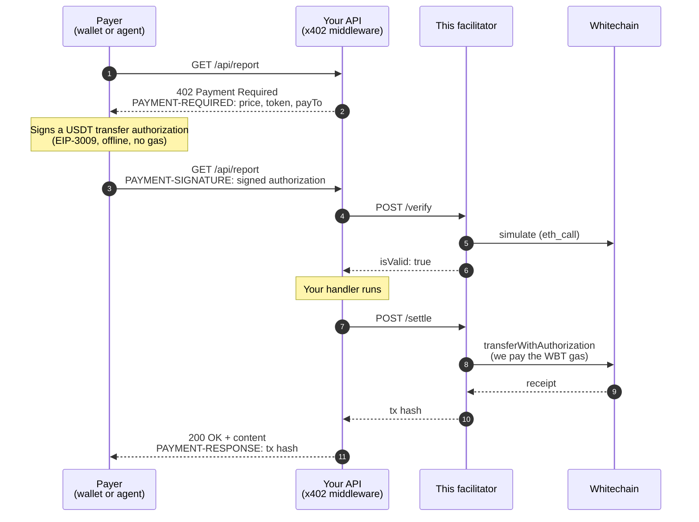

# whitechain-facilitator

**Let your API charge per request in USDT on Whitechain, without your customers ever needing gas.**

This is an [x402](https://docs.x402.org) facilitator for [Whitechain](https://docs.whitechain.io). Your API asks for payment, the customer's wallet signs a message, and we put that payment on-chain and pay the gas (WBT) ourselves. The customer only needs USDT.

It ships with a documentation site, a public log of every payment, and a browser test page at `/test`.

| | |
| --- | --- |
| **Token** | USDT only. WBT is used only for gas, and we pay it. |
| **Network** | Whitechain Sepolia (`eip155:1874`). Mainnet has no gasless USDT yet ([why](#why-not-mainnet)). |
| **Integration** | The official `@x402/*` packages, unchanged. You only change the facilitator URL. |
| **Custody** | None. Money goes straight from the payer to you. |

---

## Contents

- [How a payment works](#how-a-payment-works)
- [Architecture](#architecture)
- [Accept payments (merchants)](#accept-payments-merchants)
- [Pay for an API (agents and scripts)](#pay-for-an-api-agents-and-scripts)
- [Run your own facilitator](#run-your-own-facilitator)
- [API endpoints](#api-endpoints)
- [Supported token](#supported-token)
- [Safety limits](#safety-limits)
- [Project layout](#project-layout)
- [Testing](#testing)

---

## How a payment works



In plain words:

1. **Your API names a price.** An unpaid request gets `402` with the terms.
2. **The payer signs, but sends nothing.** Their wallet signs a message saying "move 0.01 USDT from me to this merchant". The message costs nothing and needs no WBT.
3. **We check it, then submit it.** We confirm the signature and the balance, simulate the transfer, and send the transaction. We pay the gas.
4. **The USDT goes straight to you.** It never passes through us. The signature fixes the recipient, the amount, an expiry time and a one-time nonce, so all we can decide is whether to submit it.

---

## Architecture

```mermaid
flowchart LR
    subgraph Clients
        A[Payer<br/>@x402/fetch]
        B[Merchant API<br/>@x402/express · hono · next]
    end

    subgraph App["whitechain-facilitator (Next.js)"]
        direction TB
        R["x402 routes<br/>/verify · /settle · /supported<br/>/assets · /health"]
        G["guards.ts<br/>allowlist · dust floor<br/>rate limits · signer balance"]
        X["facilitator.ts<br/>@x402/core + @x402/evm<br/>one instance per network"]
        S["chain.ts<br/>viem clients + signer"]
        L["db.ts<br/>payment log"]
        W["Website<br/>/docs · /logs · /test"]
        N[("networks.ts<br/>networks + allowed tokens")]
    end

    DB[("Postgres<br/>payments_testnet<br/>payments_mainnet")]
    WC(("Whitechain<br/>RPC"))

    A -- "402 → sign → retry" --> B
    B -- "HTTPFacilitatorClient" --> R
    R --> G --> X --> S --> WC
    X -- "lifecycle hooks" --> L --> DB
    W -- "/api/logs · /api/stats" --> L
    N -.-> G
    N -.-> X
    N -.-> W
```

**How a request moves through it**

- **Routes** sit at the bare origin (`/verify`, not `/api/verify`), because that is the URL `HTTPFacilitatorClient` calls.
- **Guards** run first, cheapest check first: string checks, then in-memory rate limits. For `/settle` only, one RPC read of the signer's balance follows. A request rejected by these checks never reaches simulation or a transaction.
- **Facilitator.** All the protocol work (signature recovery, balance checks, simulation, nonce handling, retrying a pending transaction) is done by the official `@x402/core` and `@x402/evm` libraries. None of it is written here.
- **One facilitator per network.** The x402 signer is tied to one chain, so each network gets its own instance. Both use the same key, so there is one wallet to fund.
- **Logging** hangs off the facilitator's lifecycle hooks. It never blocks or fails a payment. If the database is down, payments still settle.
- **`networks.ts`** is the one place where addresses live. Guards, clients, docs and `/assets` all read it.

---

## Accept payments (merchants)

Use the normal x402 middleware. The only Whitechain-specific line is the facilitator URL.

```bash
npm install @x402/core @x402/evm @x402/express
```

```ts
import express from "express";
import { paymentMiddleware, x402ResourceServer } from "@x402/express";
import { HTTPFacilitatorClient } from "@x402/core/server";
import { ExactEvmScheme } from "@x402/evm/exact/server";

const app = express();

const facilitatorClient = new HTTPFacilitatorClient({ url: "https://your-facilitator.example" });
const resourceServer = new x402ResourceServer(facilitatorClient)
  .register("eip155:1874", new ExactEvmScheme());

app.use(
  paymentMiddleware(
    {
      "GET /api/report": {
        accepts: {
          scheme: "exact",
          network: "eip155:1874",
          payTo: "0xYourMerchantAddress",
          price: {
            asset: "0xcedfB56113143d55b2358b8CFbB0dEB5Ad2f55a7", // USDT (Sepolia)
            amount: "10000",                                    // 0.01 USDT (6 decimals)
            extra: { name: "Tether USD", version: "1" },
          },
        },
        description: "One generated report",
      },
    },
    resourceServer,
  ),
);

app.get("/api/report", (_req, res) => res.json({ report: "the paid content" }));
app.listen(3000);
```

Hono (`@x402/hono`) and Next.js (`@x402/next`, `withX402`) work the same way. See [the merchant guide](content/docs/quickstart-merchant.mdx).

> **Why not `price: "$0.01"`?** That shorthand looks the chain up in x402's built-in token list, and Whitechain isn't in it. So you give the token address, the amount and `extra` yourself. Copy `extra` exactly: it is the token's signing domain, and if one character is off, every signature fails with nothing on-chain to debug. Verified values are served at `/assets`.

**Already taking payments on other chains?** Keep your current facilitator and add this one. `x402ResourceServer` accepts an array and sends each payment to the facilitator that supports its network:

```ts
const resourceServer = new x402ResourceServer([
  new HTTPFacilitatorClient({ url: "https://your-facilitator.example" }), // Whitechain
  new HTTPFacilitatorClient({ url: "https://x402.org/facilitator" }),     // Base, etc.
])
  .register("eip155:1874", new ExactEvmScheme())
  .register("eip155:84532", new ExactEvmScheme());
```

---

## Pay for an API (agents and scripts)

```bash
npm install @x402/fetch @x402/evm viem
```

```ts
import { wrapFetchWithPaymentFromConfig } from "@x402/fetch";
import { ExactEvmScheme } from "@x402/evm/exact/client";
import { privateKeyToAccount } from "viem/accounts";

const account = privateKeyToAccount(process.env.AGENT_PRIVATE_KEY as `0x${string}`);

const fetchWithPayment = wrapFetchWithPaymentFromConfig(fetch, {
  schemes: [{ network: "eip155:1874", client: new ExactEvmScheme(account) }],
  spendControls: {
    allowedAssets: [
      { network: "eip155:1874", asset: "0xcedfB56113143d55b2358b8CFbB0dEB5Ad2f55a7", maxAmountPerPayment: "50000" },
    ],
  },
});

const response = await fetchWithPayment("https://api.example.com/api/report");
```

The account needs USDT and **no WBT**.

The `allowedAssets` entry is required. By default the x402 client only signs for tokens in its built-in list, and Whitechain USDT isn't one of them, so without it every payment fails with `rejected by spendControls`. Keep the cap (`50000` = 0.05 USDT per payment).

Full guide: [content/docs/quickstart-agent.mdx](content/docs/quickstart-agent.mdx).

---

## Run your own facilitator

**You need:** Node 22+, pnpm, and a wallet with some testnet WBT for gas. A Postgres URL is optional; without one, payments still settle and only the public log is empty.

```bash
pnpm install
cp .env.example .env     # set FACILITATOR_PRIVATE_KEY (and DATABASE_URL if you want the log)
pnpm verify-assets       # checks the token list against the live chain
pnpm dev                 # http://localhost:3000
```

Then open:

- `/health`: is the signer funded and the RPC reachable?
- `/test`: connect a wallet and push a real payment through `/verify` and `/settle`
- `/logs`: every settlement, with explorer links

**Configuration** (full list in [`.env.example`](.env.example)):

| Variable | Required | Notes |
| --- | --- | --- |
| `FACILITATOR_PRIVATE_KEY` | yes | Pays gas. 64 hex characters, with or without `0x`. It cannot move customer funds. |
| `DATABASE_URL` | no | Postgres for the public log. Tables are created automatically on first use. |
| `NEXT_PUBLIC_FACILITATOR_URL` | no | Your public origin; used in the docs' copy-paste snippets. |
| `MAINNET_ENABLED` | no | `false` by default. |

**Deploying:**

- **A long-running server** (Railway, Fly, a VM): `pnpm build && pnpm start`, behind a proxy that sets a trusted client-IP header (`x-real-ip`, `cf-connecting-ip` or `x-vercel-forwarded-for`). Without one, the per-IP limit falls back to `x-forwarded-for`, which a caller can fake to dodge it.
- **Serverless** (Vercel): add a `vercel.json` with `{ "framework": "nextjs" }`. Each instance keeps its own rate-limit counters, so limits are looser than configured.

> **Note:** There is no daily gas budget. The most anyone can make you spend is the WBT in the signer wallet. Keep only what you're willing to spend on gas in it.

---

## API endpoints

| Route | What it does |
| --- | --- |
| `POST /verify` | Checks a payment. Read-only, no gas. |
| `POST /settle` | Submits the payment on-chain and pays the gas. |
| `GET /supported` | Networks and schemes served, plus the address that pays gas. |
| `GET /assets` | Allowed tokens with their verified signing domains (`extra`). |
| `GET /health` | Signer balance, block height, settles left. `503` when degraded. |
| `GET /api/logs` | The payment log (paginated with `before` / `nextBefore`). |
| `GET /api/stats` | Totals per network. |

`/verify`, `/settle` and `/supported` are the standard x402 v2 facilitator interface. Full request and response shapes: [content/docs/api-reference.mdx](content/docs/api-reference.mdx).

---

## Supported token

| Token | Network | Address | `extra` |
| --- | --- | --- | --- |
| USDT | Sepolia | `0xcedfB56113143d55b2358b8CFbB0dEB5Ad2f55a7` | `{ name: "Tether USD", version: "1" }` |

Settlement uses EIP-3009 `transferWithAuthorization`, so a token is supported only if its contract has that function. Tokens are allowlisted, not auto-detected: a facilitator that pays gas for any token it's handed is a free gas tap.

**Adding a token:** add it to `lib/networks.ts`, then run `pnpm verify-assets`. That checks the contract really has EIP-3009, and that the signing domain you entered matches the token's own `DOMAIN_SEPARATOR()`. Don't ship until it passes: a wrong domain makes every signature fail silently.

### Why not mainnet?

Mainnet USDT (`0xF95604a4…`) is an older Tether contract. It has `permit`, but no `transferWithAuthorization`, so it cannot be paid without gas. Sepolia USDT is the newer contract and does support it. Check it yourself:

```bash
# Sepolia: returns the EIP-3009 typehash
cast call 0xcedfB56113143d55b2358b8CFbB0dEB5Ad2f55a7 \
  "TRANSFER_WITH_AUTHORIZATION_TYPEHASH()(bytes32)" --rpc-url https://rpc.testnet.whitechain.io

# Mainnet: reverts
cast call 0xF95604a4034d8407d3F1256De56C9ae37F299cb8 \
  "TRANSFER_WITH_AUTHORIZATION_TYPEHASH()(bytes32)" --rpc-url https://rpc.whitechain.io
```

Because of this, `/supported` doesn't list mainnet. A merchant can't accidentally configure a network where every payment would fail.

### Networks

| | Sepolia | Mainnet |
| --- | --- | --- |
| Chain ID | `1874` | `1875` |
| RPC | `https://rpc.testnet.whitechain.io` | `https://rpc.whitechain.io` |
| Explorer | `https://explorer.testnet.whitechain.io` | `https://explorer.whitechain.io` |
| Faucet | `https://faucet.testnet.whitechain.io` | — |
| Gas | WBT, 5 gwei minimum, ~1s blocks | same |

---

## Safety limits

These run before the x402 libraries see the request. A request they reject is never simulated or broadcast. The signer-balance check and the mainnet switch apply to `/settle` only; `/verify` spends no gas, so it skips them.

| Check | Default | Setting |
| --- | --- | --- |
| Token must be allowlisted on that network | USDT on Sepolia | `lib/networks.ts` |
| Minimum payment (gas would exceed it otherwise) | 0.01 USDT | `MIN_AMOUNT_BASE_UNITS` |
| Rate limits per minute: IP / payer / merchant / global | 120 / 30 / 120 / 1200 | `RATE_LIMIT_*` |
| Refuse to settle when signer is low | below 0.05 WBT | `MIN_SIGNER_BALANCE_WBT` |
| Gas cap per settlement | 300,000 | `MAX_SETTLE_GAS` |
| Mainnet settlement switch | off | `MAINNET_ENABLED` |

Operational refusals (rate limited, signer unavailable or low, mainnet off) return `429`/`503` with a `Retry-After` header. Invalid payments return `200` with `isValid: false`. Nothing is broadcast in either case.

**What goes in the public log:** addresses, amounts, results, tx hashes and gas cost. Signatures and nonces are **never** stored. Error text is scrubbed of RPC URLs and long hex values before it's saved.

---

## Project layout

```
lib/
  networks.ts          networks + allowed tokens — the only place addresses live
  chain.ts             viem clients, the gas-paying signer, signing-domain checks
  facilitator.ts       one x402 facilitator per network, plus logging hooks
  facilitator-http.ts  request parsing shared by /verify and /settle
  guards.ts            allowlist, dust floor, rate limits, signer balance, mainnet switch
  db.ts                payment log: insert, list, stats
  schema.ts            log tables, created automatically on first use
  redact.ts            scrubs error text before it's stored or returned

app/
  (facilitator)/       x402 API at the bare origin: verify, settle, supported, assets, health
  api/                 logs + stats JSON for the website
  docs/  logs/  test/  website pages

content/docs/          the documentation (MDX)
scripts/               verify-assets, smoke, migrate, guards.test
```

Only want the API? Delete `app/page.tsx`, `app/globals.css`, `app/docs`, `app/logs`, `app/test`, `app/api`, `components/`, `content/`, `mdx-components.tsx` and `lib/docs-nav.ts`, then reduce `app/layout.tsx` to a bare `<html><body>{children}</body></html>`. Nothing else in `lib/` depends on the website.

---

## Testing

```bash
pnpm typecheck
pnpm test            # safety checks, no database or RPC needed
pnpm verify-assets   # token list vs. the live chain
pnpm smoke           # real end-to-end payment (needs a funded payer)
```

`pnpm smoke` is the test that proves the product. It pays with the same `@x402/evm` client an agent uses, then checks:

- the payer had **zero WBT** before and still has zero after, so gas really was sponsored
- the payer's USDT dropped by exactly the amount, and `payTo` received exactly that
- the facilitator's WBT dropped, so it paid the gas
- `/assets` advertises the same signing domain the payment was signed with
- the payment shows up in the public log

It needs `SMOKE_PAYER_PRIVATE_KEY` (holds USDT, no WBT) and `SMOKE_PAY_TO`. By default it targets `http://localhost:3000` on testnet. To test a deployed instance:

```bash
pnpm smoke -- --url=https://your-facilitator.example --network=testnet
```

---

## License

Apache-2.0.

Whitechain and WhiteBIT are trademarks of their owners. This project is not affiliated with or endorsed by them, Coinbase, Circle, or the x402 Foundation.
